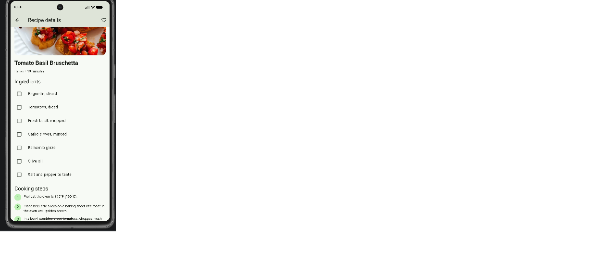
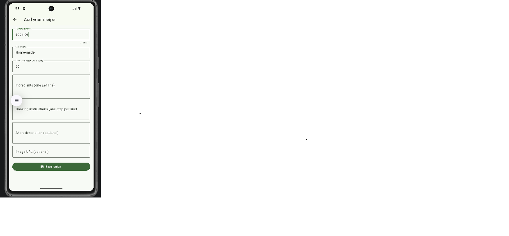

# RecipeHub 🍽️

## Flutter Group Project

### Project Overview

RecipeHub is a Flutter-based recipe application developed collaboratively by our team. It allows users to explore recipes, view recipe details, add their own recipes, and manage their favorite recipes through a simple and user-friendly interface.

The application uses Provider for state management and Shared Preferences for local data persistence.

### Project Objectives

- Develop a functional recipe application using Flutter.
- Provide a simple and user-friendly interface.
- Implement state management using Provider.
- Support recipe browsing, details, and favorites.
- Allow users to add and manage personal recipes.
- Practice collaborative development using Git and GitHub.

### Features

- Browse available recipes.
- View recipe ingredients and preparation steps.
- Add new personal recipes.
- Mark and view favorite recipes.
- Profile screen.
- About screen.
- Form validation.
- Local data persistence.

### Technologies Used

| Technology | Purpose |
|---|---|
| Flutter | Cross-platform application development |
| Dart | Programming language |
| Provider (ChangeNotifier) | State management |
| Shared Preferences | Local data persistence |
| Android Studio | Application development |
| Git | Version control |
| GitHub | Repository hosting and collaboration |

### Project Structure

```text
lib/
├── models/
├── providers/
├── screens/
├── services/
├── widgets/
└── main.dart

test/
android/
```

*Note: This is a general overview of the project structure.*

### Installation and Setup

#### Prerequisites

- Flutter SDK
- Dart SDK
- Android Studio or Visual Studio Code
- Git

#### How to Run the Project

1. Clone the repository:

   ```bash
   git clone https://github.com/248x1a42g1/RecipeHub.git
   ```

2. Open the project directory:

   ```bash
   cd RecipeHub
   ```

3. Open the project in Android Studio or Visual Studio Code.

4. Install dependencies:

   ```bash
   flutter pub get
   ```

5. Run the application:

   ```bash
   flutter run
   ```

### Testing

The application can be tested using Flutter's testing tools.

Run:

```bash
flutter test
```

Testing includes:

- Recipe browsing.
- Recipe details.
- Add recipe validation.
- Favorites functionality.
- Profile and About screens.
- Local data persistence.

### App Screenshots

The following screenshots demonstrate the main application screens.

#### Home Screen


#### Recipe Details Screen



#### Favorites Screen


#### Add Recipe Screen



*Note: Confirm that the screenshot filenames match the actual files in your repository. GitHub image paths are case-sensitive.*

### Team Member Contributions

Select a team member below to view their individual contributions.

<details>
<summary><strong>TUMMALA VENKATESWARLU — 248x1a42g1 (Team Leader)</strong></summary>

#### Contributions

- Project planning and coordination.
- GitHub repository management.
- Core application development.
- Recipe feature integration.
- Provider state management.
- Application testing.
- Final project integration.

</details>

<details>
<summary><strong>SARKA VENKATESH — 248x1a42d7 (Team Member)</strong></summary>

#### Contributions

- Profile screen development.
- About screen development.
- User interface implementation.
- Screen integration.
- Application testing.

</details>

### State Management

RecipeHub uses Provider with ChangeNotifier for state management. This helps separate application logic from the user interface and allows screens to update when application data changes.

### Data Persistence

Shared Preferences is used to store relevant application data locally. This allows saved information to remain available when the application is reopened.

### Future Enhancements

- Add recipe search and filtering.
- Improve recipe categorization.
- Add user authentication.
- Add cloud-based data synchronization.
- Improve user interface and accessibility.
- Add more recipe management features.

### Conclusion

RecipeHub demonstrates the development of a functional Flutter recipe application using Provider state management and local data persistence. The project provides practical experience in mobile application development, UI design, state management, testing, and collaborative development using Git and GitHub.

### Repository

[RecipeHub — GitHub Repository](https://github.com/248x1a42g1/RecipeHub)

### Releases

[View RecipeHub Releases](https://github.com/248x1a42g1/RecipeHub/releases)
